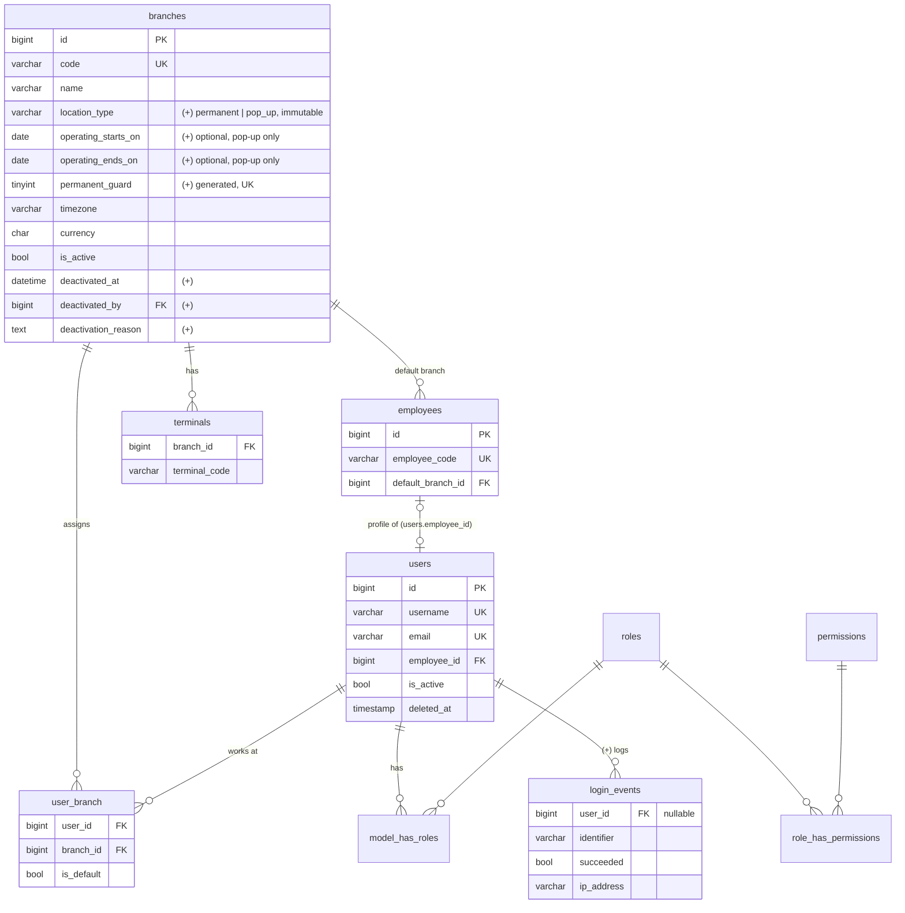
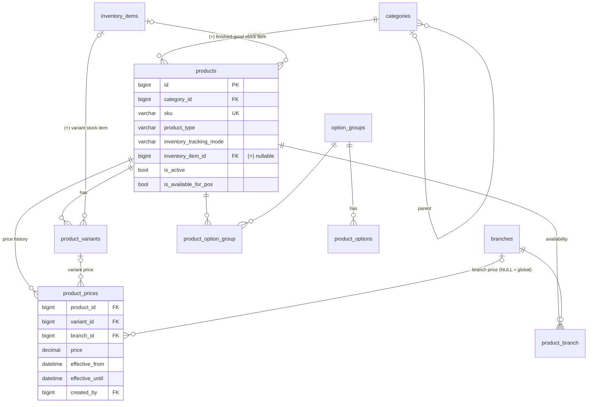
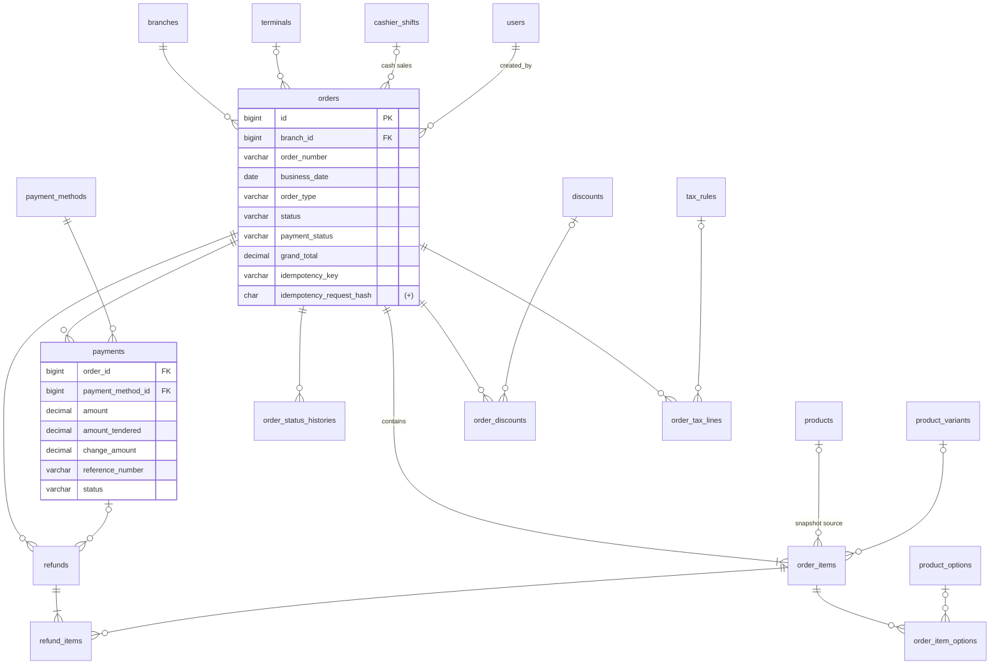
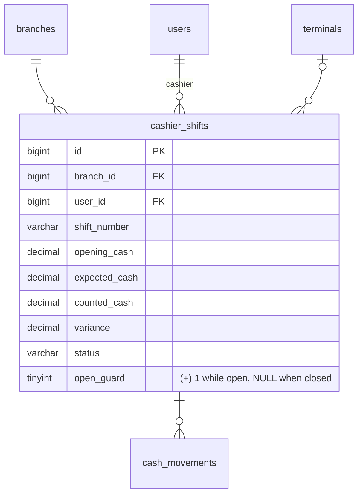
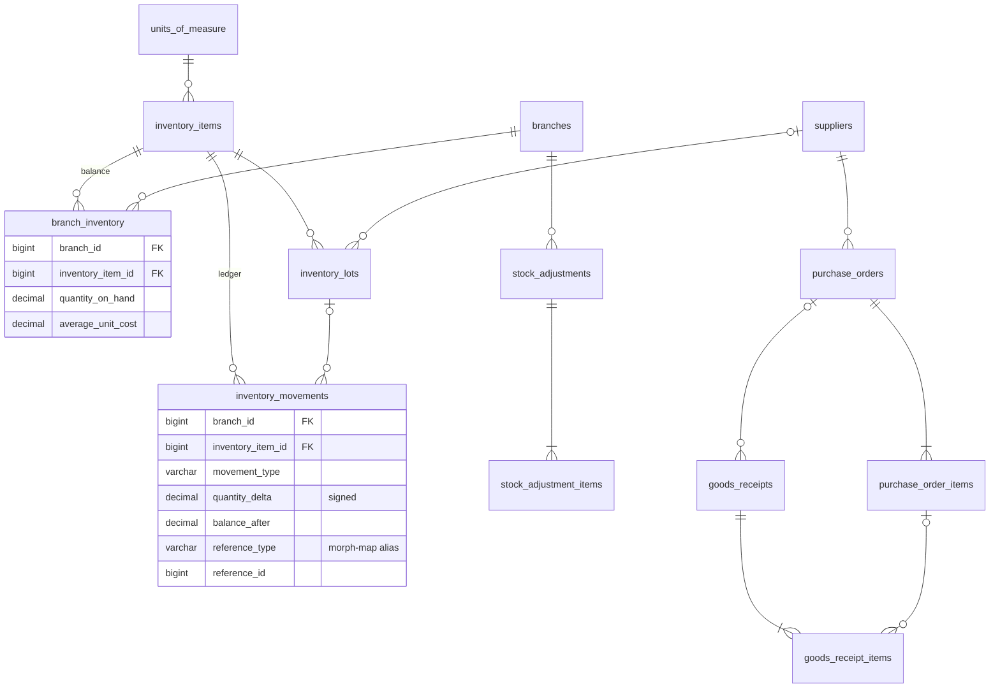
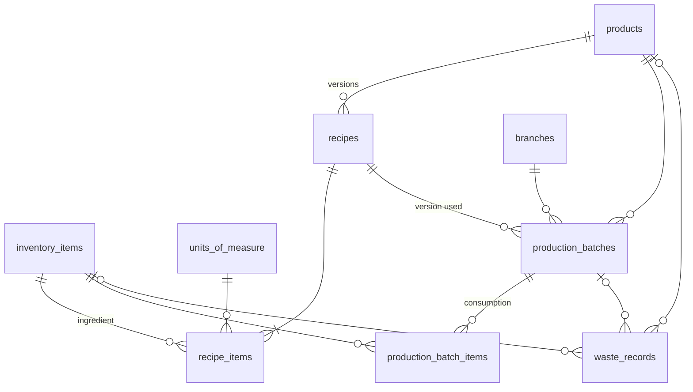

# Brevon POS — Entity Relationship Design

Source of truth for field definitions: `docs/BREVON-SRS-v1.1.md` §8 (SRS **v1.1**). This document records the relationships, the additions/changes proposed in `docs/DECISIONS.md`, migration order, and the phase in which each table is created. Migrations must match this document; update it first when the schema changes.

Conventions: BIGINT unsigned PKs; money `DECIMAL(12,2)`; unit cost `DECIMAL(14,4)`; quantity `DECIMAL(14,3)`; timestamps UTC; FKs `RESTRICT` on delete unless stated; `(+)` = addition to SRS schema.

---

## 1. Organization and access

Constraints: UNIQUE `user_branch(user_id, branch_id)`; UNIQUE `terminals(branch_id, terminal_code)`; spatie tables per package migration (teams off).

**Operating locations (SRS v1.1, D-057–D-066).** `branches` holds both the single permanent branch and temporary pop-up stands. Constraints: UNIQUE `code`; UNIQUE `permanent_guard` (generated `IF(location_type='permanent',1,NULL)`) → at most one permanent location; CHECK `operating_ends_on >= operating_starts_on`; app rule: pop-up dates optional (enforced only when set), permanent has none. Phase 7 adds `stock_transfers` / `stock_transfer_items` for the main → pop-up doughnut dispatch (D-063). Locations and terminals are never deleted (no soft delete); every FK to `branches` is RESTRICT, so a closed pop-up keeps all orders, shifts, balances, movements, and audit rows. `branches.acceptsNewOperationsOn(date)` = active AND (permanent OR date within the operating period) (D-059).

## 2. Catalog and pricing

Rules: current price = latest row with `effective_from ≤ now < coalesce(effective_until, ∞)`, in the order variant + location → variant → location → base (D-087). New price closes the previous row (`effective_until`) — rows are never updated otherwise. UNIQUE `product_branch(product_id, branch_id)`, `product_option_group(product_id, option_group_id)`. **Built in Phase 3:** generated columns `product_prices.scope_key` / `open_guard` (UNIQUE: one open price per scope), `product_variants.default_guard` (one default variant per product), `settings.branch_scope` (UNIQUE with `key`); CHECKs `products_stock_link_check` (finished_stock ⇒ stock item, D-085/D-089), price ≥ 0, `effective_until > effective_from`, option `price_delta ≥ 0`, single-choice groups max 1.

## 3. Orders, payments, refunds, discounts, tax

**No customer data (D-067):** there is no `customers` table and `orders` has no customer FK, name, phone, email or address columns. `orders.branch_id`, `terminal_id`, `cashier_shift_id` are copied from the cashier's open shift (D-060).

Constraints: UNIQUE `orders(branch_id, order_number)`, UNIQUE `orders(branch_id, idempotency_key)`; INDEX `orders(branch_id, business_date, status)`, `orders(cashier_shift_id)`, `payments(order_id, status)`, `payments(payment_method_id, reference_number)`, `order_items(product_id)`. All FKs from orders/payments/refunds RESTRICT. Order items keep `sku_snapshot`, `product_name_snapshot`, `variant_name_snapshot`, `unit_price` (FR-022, BR-015).

`payment_status` values: `unpaid`, `pending_verification`, `paid`, `partially_refunded`, `refunded`.

## 4. Cash management

Constraints: UNIQUE `cashier_shifts(branch_id, user_id, open_guard)` (at most one open shift per cashier per location); UNIQUE `cashier_shifts(terminal_id, open_guard)` (at most one open shift per terminal, D-060); `terminal_id` required for new shifts and `branch_id` copied from the terminal; UNIQUE `cashier_shifts(branch_id, shift_number)`; INDEX `(branch_id, user_id, status)`.

## 5. Inventory, purchasing

Invariant: for every (branch, item), `branch_inventory.quantity_on_hand = Σ inventory_movements.quantity_delta`. All writes go through one `InventoryLedger` service that locks the `branch_inventory` row (`FOR UPDATE`, rows locked in ascending item-id order to avoid deadlocks), checks negative stock, inserts the movement with `balance_after`, and updates the projection in the same transaction. Balances are per location, pop-ups included. `transfer_in`/`transfer_out` movement types are used only by the Phase 7 main → pop-up dispatch; rejected by the ledger before then (D-063). UNIQUE `branch_inventory(branch_id, inventory_item_id)`; INDEX `inventory_movements(branch_id, inventory_item_id, created_at)`, `purchase_orders(branch_id, status)`.

## 6. Recipes and production

UNIQUE `recipes(product_id, version)`. Posting a batch: one transaction, status `draft → posted` guarded by `WHERE status='draft'` (prevents double posting), ingredient movements `production_consumption`, output movement `production_output` on the product's finished-good item.

## 7. Audit and system

| Table              | Notes                                                                                                                                                                     |
| ------------------ | ------------------------------------------------------------------------------------------------------------------------------------------------------------------------- |
| `audit_logs`       | branch_id, user_id nullable; event; auditable_type (morph alias) + id; old/new JSON; ip; UA; created_at. INDEX `(auditable_type, auditable_id, created_at)`. Append-only. |
| `settings`         | UNIQUE `(branch_id, key)`; NULL branch = global. No secrets.                                                                                                              |
| `number_sequences` | UNIQUE `(branch_id, sequence_type, business_date)`; locked increment.                                                                                                     |
| `notifications`    | Laravel standard (UUID PK).                                                                                                                                               |
| Framework          | `password_reset_tokens`, `sessions`, `cache`, `cache_locks`, `jobs`, `job_batches`, `failed_jobs`.                                                                        |

## 8. Migration order (FK-safe)

1. Framework: users (base), password_reset_tokens, sessions, cache, jobs — Phase 1
2. branches (with location columns, D-057/D-058/D-062 — `deactivated_by` FK added after users exist; users table already exists from step 1), employees, alter users (+employee_id, username, is_active, last_login_at, soft deletes), user_branch, terminals, spatie permission tables, login_events, audit_logs — **Phase 2 (done)**; `settings` → Phase 3, `number_sequences` → Phase 4, `notifications` → when first needed (D-083). Pop-up management UI and operating-date rules in Phase 3
3. settings, categories, units_of_measure, inventory_items, products (+inventory_item_id), product_variants, product_prices, product_branch, option_groups, product_option_group, product_options — **Phase 3 (done)** (units/inventory_items stubs needed for the product link; full inventory UI in Phase 7)
4. branch_inventory, inventory_movements — Phase 4 (ledger core, D-051)
5. payment_methods, cashier_shifts, orders, order_items, order_item_options, order_status_histories, payments — Phase 4
6. cash_movements — Phase 6
7. suppliers, inventory_lots, stock_adjustments(+items), purchase_orders(+items), goods_receipts(+items) — Phase 7
8. recipes, recipe_items, production_batches, production_batch_items, waste_records — Phase 8
9. discounts, order_discounts, tax_rules, order_tax_lines, refunds, refund_items — Phase 9

(`inventory_lots` references `suppliers`, so both land in Phase 7; `inventory_movements.inventory_lot_id` FK is added by an alter migration in Phase 7.)
